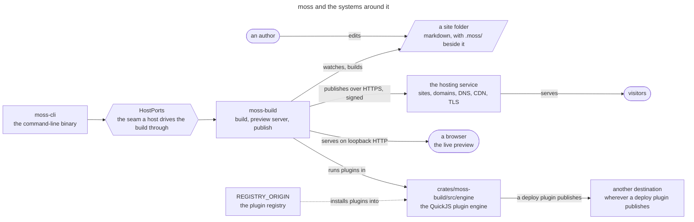
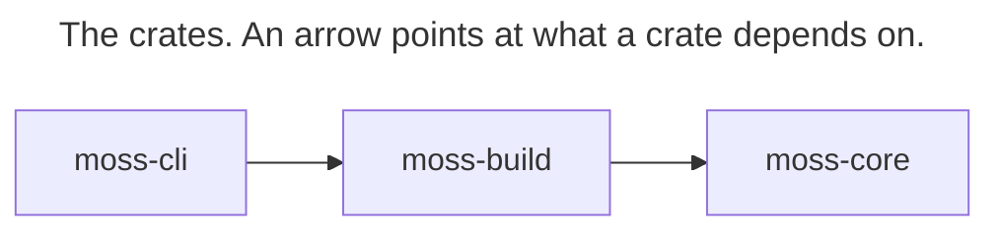

# Architecture

What each crate in this repository is for, what it may depend on, and where new code goes. Read it before creating or moving a file.

## What moss is designed for: a low floor and a high ceiling

The floor is how little a person must learn to make a simple site. It should be close to nothing moss-specific: a folder of markdown files is the site, the folders are its structure, and the syntax is the one other tools already read — CommonMark, YAML frontmatter, wikilinks, pandoc-style fenced divs and attributes. A site written for moss should read correctly in Obsidian, on GitHub or in a plain editor, and a folder written for those should build in moss.

The ceiling is what a site can ship. Anything a hand-built website can put on the web, a moss site can put there too. Where markdown cannot say something, there is an escape hatch — raw HTML in a page, a partial, the theme's own CSS and JavaScript, a plugin — and the hatch is still a better place to author than starting from scratch: the words stay in markdown a person can read and edit, and moss keeps doing everything else (images, navigation, feeds, publishing).

Both hold at once, and neither is bought with the other. A capability that makes a simple site learn new syntax raises the floor; a convenience that makes some web feature impossible lowers the ceiling. When a site built with moss has to ship less than its hand-built version, or reach it only through a workaround, that is a moss defect, and it is fixed in moss rather than in the site. The logic stays small enough to say: a rule fits in one sentence ("a `footer.md` at the top of the site is the footer"), and a feature composes concepts moss already has before it adds a new one.

Real sites are the test. Each site built with moss is checked against both goals: which simple parts needed anything moss-specific, and which parts of the design moss could not ship.

## What moss touches

The author edits a folder; `moss-build` watches it, builds it and serves the result to a browser on loopback. A publish takes one of the routes `deploy::route::DeployRoute` names: moss builds and seals the site and uploads it to the hosting service over HTTPS, each request signed with the folder's identity keypair (`seta`); or it uploads a directory another tool built to the hosting service, without running its own build; or it hands the whole publish to a deploy plugin. Plugins run in the QuickJS engine and are installed from the one origin `REGISTRY_ORIGIN` names. Any program that links `moss-build` can host all of this through `HostPorts` and the ports beside it in `build/ports`; `moss-cli` is the one in this repository.

## Crates

| Crate | What it's for | What it must never depend on |
|---|---|---|
| `moss-core` | pure Rust: markdown parsing, frontmatter typing, schema validation, wikilink/embed resolution, the design-token and HTML-class contract | filesystem I/O, network I/O, any async runtime |
| `moss-build` | everything that runs without a window: the build pipeline (scan → render → emit), the preview server, the publish path, the plugin engine, the HTTP client for the hosting service | any GUI toolkit, direct or transitive (no Tauri, no wry, no webview) |
| `moss-cli` | the `moss` binary | anything beyond `moss-build` — it links `moss-build` only, never `moss-core` directly |

`moss-core` carries no rendering engine of its own: it is published to crates.io (`publish = true` in its `Cargo.toml`), so every dependency it adds is a commitment every consumer's `Cargo.lock` inherits, and an engine with embedded fonts or a rasterizer — math typesetting (RaTeX, pinned in `moss-build`'s `Cargo.toml`) and the place map (resvg/usvg plus an embedded tile pack) — stays out; both live in `moss-build` instead and reach page output through `moss-core`'s `RenderHooks` trait, whose `render_math` default just emits the plain escaped-source fallback rather than typesetting anything.

## Dependency direction

Nothing here depends back on the CLI or on any consumer.

<!-- architecture:crate-graph:start -->
<!-- Generated by `node scripts/gen-architecture-diagrams.mjs` from `cargo metadata`; do not hand-edit. -->

<!-- architecture:crate-graph:end -->

`node scripts/gen-architecture-diagrams.mjs` writes the graph above from `cargo metadata`, and `--check` fails when it is stale, when a diagram in this file does not parse in [pele](https://pele.run/) (the Mermaid renderer the diagrams are drawn for; GitHub draws the same source with Mermaid), or when a node marked `:::crate`, `:::path` or `:::symbol` names a crate, file or item that does not exist.

A closed desktop app consumes these crates as a git dependency — pinned to a branch and locked by its own `Cargo.lock`/`pnpm-lock.yaml`, not a submodule. That app is downstream of this repository, not the other way around: nothing here may depend on it, reference its internal paths, or assume it exists.

## `moss-build/src` module map

One line each, matching `crates/moss-build/src/lib.rs` as it stands today:

- `advisory` — the recovery/advisory vocabulary shared by every long-running job producer (build, domain, deploy, plugins); pure values, no I/O.
- `config` — the `.moss/config.toml` reader, the pure migration transform, and the one write primitive shared by the CLI and the compiler.
- `moss_paths` — owns the on-disk build layout: the paths every build generation writes to.
- `nested_roots` — detects and classifies nested moss roots, so a build never treats a cloud mount, a home directory, or a folder that is itself a site as safe to descend into.
- `vault_root` — the compiler's root identity: which folder is the site being built.
- `build` — the compiler itself: scan → render → emit, the staging/generations build-directory model, file watching. How it records the inputs it read and decides when the preview may show a render: [build inputs and preview readiness](docs/reference/build-inputs-and-preview-readiness.md).
- `commands` — the engine's command table: every command a moss UI sends, one typed function each, and the `CommandHost` a transport supplies (the HTTP carrier's `Session`, or a host's in-process one).
- `editor` — the editor backend: path resolution, file tree, content parse/persist, source-asset bytes; the cores `commands` calls.
- `engine` — the QuickJS plugin execution engine.
- `i18n` — language detection, UI string translation, and translation linking for multilingual sites.
- `ops` — long-running processes over a built site: the preview server (`ops/serve`) and the file-watch debouncer (`ops/watch`).
- `tasks` — the task/progress primitive: the registry, the plugin-task router, and the wire snapshot sent to any frontend.
- `types` — data types shared across the build tree.
- `cli` — CLI-facing pieces that ride the build itself: agent-guidance sync, the `describe`/`doctor`/`list` commands, the shared command table.
- `deploy` — the windowless half of publishing: the upload latch, the upload window, the mass-removal safety gate, progress reporting, the landed-publish record.
- `identity` — vault identity: the keypair vocabulary, the on-disk identity service, the file-based keystore.
- `infra` — shared infrastructure the build tree and the plugin runtime both reach: atomic file writers, the advisory display vocabulary, the app-data directory resolver, the surgical `config.toml` editor.
- `platform` — cloud-file materialization primitives (today: macOS file-provider I/O policy and file coordination).
- `seta` — the HTTP client for the hosting service: sites, domains, DNS, CDN, TLS, request signing.
- `plugins` — the plugin vocabulary, the bundled-plugin installer and registry client, and the plugin manager runtime.
- `system` — small OS-facing utilities the build tree needs: per-folder session state, proxy resolution, a resumable verified download, "reveal in file manager".
- `vault` — the vault family's crossed members: path aliases and the plugin-facing filesystem sandbox.

## Size rules

A Rust or TypeScript source file (tests excluded) whose production code-line count exceeds 800 needs a baseline entry in `scripts/ratchet-baseline.open.json`: a ceiling that is a multiple of 100. Code lines exclude blank lines and comment-only lines, so a file is not penalised for documenting itself; a line with code and a trailing comment counts. The ceiling can only shrink, except through an explicit, reasoned `accept`. A file over 1000 code lines needs a further, written disposition: a one-line reason (and what would retire it) in the baseline's `prod_lines_per_file.oversized{}` map, the same shape a directory with 30 or more direct children already needs. A file over that line with no disposition is red; a disposition whose file has dropped back to 1000 lines or under is stale, and `tighten` removes it.

A file whose length measures a vocabulary rather than logic (a table of component classes, schema fields or UI strings) is listed with a reason in `prod_lines_per_file.data_tables{}` and is exempt from both limits. `check` re-verifies every listed file on each run: at most 5 function definitions and at most 2 branch points per 100 code lines, so logic cannot hide in a table; a file that breaks a bound turns red and says which.

A file ceiling alone invites moving code around a long function without improving it, so a second row measures functions: every production function over 200 code lines is keyed `<path>::<fn name>` and gets a ceiling banded to 50 that can only shrink, with the same `tighten` and `accept --path <path>::<fn name>` mechanics. A function over 500 code lines needs a written disposition in that row's `oversized{}` saying what decomposition it needs. A disposition that waits on something is written `{"reason": "...", "waits_on": "<repo-relative path>"}`: `check` is red once that path exists, and red for prose that says it waits without naming a path. `scripts/ratchet.mjs check` enforces all of this; see that script's own header for the exact rules and commands. The Known-debt list below is generated from the `oversized{}` maps by `node scripts/ratchet.mjs docs`, and `check` fails if it has drifted — edit the baseline to change it, not this file directly.

Each crate's production dependencies (`[dependencies]` and `[target.*.dependencies]`) are counted the same way: the count can only shrink, and a new dependency needs an `accept` whose reason says what needs it, since one direct entry can bring in hundreds of transitive crates.

Byte-index slices of a `&str` (`&s[..n]`) panic when `n` falls inside a multi-byte character, so moss-core denies `clippy::string_slice` in production code. moss-build and moss-cli do not, and a count per crate (`string_slices_per_crate`) lets existing slices be fixed one at a time while no new one lands: `node scripts/ratchet.mjs slices` measures it with a clippy build (so `check` only validates the row's shape), `--tighten` lowers it, and `--accept "<reason>"` raises it.

## Where new code goes

New code lands in the module that already owns the concern it touches. A relocation — moving existing code to a different module — is never scheduled for its own sake; it happens only alongside a change that already has a reason to touch that code.

## Before adding an abstraction

Three questions, answered before building: how many real callers exist today (two or more)? What does undoing it cost? What observable event would prove it wrong?

## Known debt

Every function over 500 code lines, then every file over 1000 (tests excluded, counted the same way `scripts/ratchet.mjs` counts them), with the reason recorded for it in `scripts/ratchet-baseline.open.json`'s `lines_per_function.oversized{}` and `prod_lines_per_file.oversized{}`. Generated by `node scripts/ratchet.mjs docs` — edit the baseline, then regenerate, rather than editing the table below by hand; `scripts/ratchet.mjs check` fails if the two disagree.

<!-- ratchet:known-debt:start -->
Functions over 500 code lines:

| Function | Code lines | Disposition |
|---|---:|---|
| `crates/moss-build/src/build/render/blocking.rs::generate_blocking_content_for_build` | 1848 | One function runs the whole blocking build in sequence: source scan and uid normalization, page map, content graph and folder languages, theme and assets, the authored page loop, generated term, place and index pages, feeds and sitemap, then the hand-off to the background context; the phases share mutable state (the pending manifest, warnings, source records) instead of passing results. Fix the state model first: give each phase an explicit result (source set, authored pages, generated pages, site files) that the next phase and the background context consume, then split along those results. |
| `crates/moss-build/src/i18n/strings.rs::t` | 798 | A match on the key with a nested match on the language in every arm: a translation table written as a function, not logic. It retires when the strings are a table keyed by language and key that `t` looks up, which also lets the data-table test cover the file. |
| `crates/moss-build/src/build/markdown/pipeline.rs::process_markdown_file` | 698 | The body is already numbered phases (parse to the typed AST, wikilink embeds, URL resolution, hero extraction, cover image capture, an unresolved-URL safety net, render through the hooks) plus a raw-media warning pass, threading local variables between them. Introduce one typed-document record (AST, hero, cover image, diagnostics) that each phase takes and returns, then lift each phase into a function over it. |
| `crates/moss-build/src/build/pipeline.rs::build_inner` | 643 | Numbered steps and the background dispatch in one body: the preview rest point, previous hashes, staging prepare and sweep, the blocking render, slot injection, hash comparison, then the hand-off to the background phase, each step reading what the last left in locals. Give each step an explicit result (staging plan, rendered stage, change set) so the background hand-off takes a change set instead of a dozen locals. |
| `crates/moss-build/src/build/render/html.rs::render_page` | 544 | One function decides the page's facts (template kind, locator placement, indexability, title, share card, date line), then composes the body for every page kind and fills the shell. Compute one page-facts record at the top, give each body kind (article, folder index, home) its own function returning its fragments (head extras, article, sidebar, post-article), and let the shell fill take only those fragments. |

Files over 1000 code lines:

| File | Code lines | Disposition |
|---|---:|---|
| `crates/moss-build/src/build/render/blocking.rs` | 2130 | The blocking build coordinates source readiness, parsing, typed document preparation, and distinct authored, term, and place bodies. Folder planning and common page chrome now have single owners; further reduction should give document preparation an explicit result consumed by those body renderers. |
| `crates/moss-build/src/build/media/image.rs` | 1493 | The image half of media conversion: WebP encode, EXIF, resize, CAS store, dispatched on threads under a megapixel budget. It shares output registration and the coherence summary with video through output_emit; its dispatch, concurrency and state model differ on purpose, so no further shared skeleton is planned. |
| `crates/moss-build/src/build/markdown/pipeline.rs` | 1359 | The sole markdown-to-HTML entry point, process_markdown_file (one long function whose phases are already numbered), plus URL classification and prettification. It shrinks by giving each phase its own result instead of locals shared across the function; moving URL handling to another file would only relocate it. |
| `crates/moss-build/src/build/media/video.rs` | 1344 | The video half of media conversion, grown by a long tail of individually necessary fixes (poster repair, HLS ladder capping and healing, CAS-oid threading): a 2-permit semaphore with superseding runs. It shares output registration and the coherence summary with image through output_emit; its dispatch, concurrency and state model differ on purpose, so no further shared skeleton is planned. |
| `crates/moss-core/src/ast/shortcode_extract.rs` | 1319 | Pre-parse :::shortcode extraction has to walk the source once, skip every kind of inert region, and track nested opener/closer state together, so the pass doesn't decompose along the shortcode-type boundary it would naturally be split on. |
| `crates/moss-core/src/ast/parser.rs` | 1313 | The one function that walks every pulldown_cmark::Event variant into the typed AST, including heading-ID assignment; retires only if event handling splits by node kind, which would scatter a single parse pass across several files for no behavior change. |
| `crates/moss-build/src/build/pipeline.rs` | 1268 | The run()/build() entry point for every build path (CLI, GUI, preview, watch), covering the blocking and background phases end to end. Most of it is build_inner, whose decomposition is written in the lines_per_function disposition; the file shrinks as that function does. |
| `crates/moss-build/src/build/folder_embed.rs` | 1218 | Three resolution branches (content folder, static-index folder, missing) share one marker-parsing frontend; retires by extracting that shared parsing into its own file first, which none of the three branches currently need enough to justify. |
| `crates/moss-build/src/build.rs` | 1127 | Crate root: dozens of submodule declarations plus the single run_pipeline entry point (zero-flicker staging, seal, ship, generation GC) that the rest of build/ hangs off of; deliberately free of any GUI-framework dependency via the HostPorts ports. run_pipeline_body (about 450 code lines) is most of it: scan once, re-scan after content-producing hooks, the native process phase, then the build. It needs the scan as an explicit value carried across the re-scan before the phases can move to their own file. |
| `crates/moss-build/src/build/page/meta.rs` | 1033 | Open Graph/Twitter/Schema.org JSON-LD tag builders sit alongside the larger markdown-to-plain-text excerpt extractor (first_paragraph_excerpt, non_prose_view, strip_markdown_inline) that page descriptions are derived from, plus hreflang and HTML/JSON escaping helpers; retires by moving the excerpt-extraction half — the larger of the two — into its own file, which nothing here currently plans. |
| `crates/moss-build/src/build/media/pipeline.rs` | 1011 | Asset copy, cleanup and sync for the background phase, deliberately the only place that writes the stage or seals cleanup bookkeeping per its own module doc. copy_deferred_assets (about 390 code lines) is most of it: one walk applies the sized-raster, CAS and source-metadata fast paths and prunes stale entries. It needs an explicit walk result (found keys, carried-forward entries, counters) before the passes can split. |
<!-- ratchet:known-debt:end -->

None of these are a waiver by design; each is unfinished decomposition, tracked (and only allowed to shrink) through the baseline referenced above.

Build output is checked byte-for-byte by a snapshot suite: `crates/moss-build/tests/snapshot_tests.rs`, with fixtures under `crates/moss-build/tests/fixtures/snapshot-sites/`. Run it with `cargo test -p moss-build --test snapshot_tests`; regenerate the fixtures with `SNAPSHOTS=overwrite cargo test -p moss-build --test snapshot_tests`.
