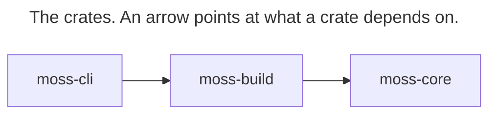

# Architecture

What each crate in this repository is for, what it may depend on, and where new code goes. Read it before creating or moving a file.

## What moss is designed for: a low floor and a high ceiling

The floor is how little a person must learn to make a simple site. It should be close to nothing moss-specific: a folder of markdown files is the site, the folders are its structure, and the syntax is the one other tools already read — CommonMark, YAML frontmatter, wikilinks, pandoc-style fenced divs and attributes. A site written for moss should read correctly in Obsidian, on GitHub or in a plain editor, and a folder written for those should build in moss.

The ceiling is what a site can ship. Anything a hand-built website can put on the web, a moss site can put there too. Where markdown cannot say something, there is an escape hatch — raw HTML in a page, a partial, the theme's own CSS and JavaScript, a plugin — and the hatch is still a better place to author than starting from scratch: the words stay in markdown a person can read and edit, and moss keeps doing everything else (images, navigation, feeds, publishing).

Both hold at once, and neither is bought with the other. A capability that makes a simple site learn new syntax raises the floor; a convenience that makes some web feature impossible lowers the ceiling. When a site built with moss has to ship less than its hand-built version, or reach it only through a workaround, that is a moss defect, and it is fixed in moss rather than in the site. The logic stays small enough to say: a rule fits in one sentence ("a `footer.md` at the top of the site is the footer"), and a feature composes concepts moss already has before it adds a new one.

Real sites are the test. Each site built with moss is checked against both goals: which simple parts needed anything moss-specific, and which parts of the design moss could not ship.

## What moss touches

The author edits a folder; `moss-build` watches it, builds it and serves the result to a browser on loopback. A publish takes one of the routes `deploy::route::DeployRoute` names: moss builds and seals the site and uploads it to the hosting service over HTTPS, each request signed with the folder's identity keypair (`seta`); or it uploads a directory another tool built to the hosting service, without running its own build; or it hands the whole publish to a deploy plugin. Plugins run in the QuickJS engine and are installed from the one origin `REGISTRY_ORIGIN` names. Any program that links `moss-build` can host all of this through `HostPorts` and the ports beside it in `build/ports`; `moss-cli` is the one in this repository.

## Crates

| Crate | What it's for | What it must never depend on |
|---|---|---|
| `moss-core` | pure Rust: markdown parsing, frontmatter typing, schema validation, wikilink/embed resolution, the design-token and HTML-class contract | filesystem I/O, network I/O, any async runtime |
| `moss-build` | everything that runs without a window: the build pipeline (scan → render → emit), the preview server, the publish path, the plugin engine, the HTTP client for the hosting service | any GUI toolkit, direct or transitive (no Tauri, no wry, no webview) |
| `moss-cli` | the `moss` binary | anything beyond `moss-build` — it links `moss-build` only, never `moss-core` directly |

`moss-core` carries no rendering engine of its own: it is published to crates.io (`publish = true` in its `Cargo.toml`), so every dependency it adds is a commitment every consumer's `Cargo.lock` inherits, and an engine with embedded fonts or a rasterizer — math typesetting (RaTeX, pinned in `moss-build`'s `Cargo.toml`) and the place map (resvg/usvg plus an embedded tile pack) — stays out; both live in `moss-build` instead and reach page output through `moss-core`'s `RenderHooks` trait, whose `render_math` default just emits the plain escaped-source fallback rather than typesetting anything.

## Dependency direction

Nothing here depends back on the CLI or on any consumer.

<!-- architecture:crate-graph:start -->
<!-- Generated by `node scripts/gen-architecture-diagrams.mjs` from `cargo metadata`; do not hand-edit. -->

<!-- architecture:crate-graph:end -->

`node scripts/gen-architecture-diagrams.mjs` writes the graph above from `cargo metadata`, and `--check` fails when it is stale, when a diagram in this file does not parse in [pele](https://pele.run/) (the Mermaid renderer the diagrams are drawn for; GitHub draws the same source with Mermaid), or when a node marked `:::crate`, `:::path` or `:::symbol` names a crate, file or item that does not exist.

A closed desktop app consumes these crates as a git dependency — pinned to a branch and locked by its own `Cargo.lock`/`pnpm-lock.yaml`, not a submodule. That app is downstream of this repository, not the other way around: nothing here may depend on it, reference its internal paths, or assume it exists.

## `moss-build/src` module map

One line each, matching `crates/moss-build/src/lib.rs` as it stands today:

- `advisory` — the recovery/advisory vocabulary shared by every long-running job producer (build, domain, deploy, plugins); pure values, no I/O.
- `config` — the `.moss/config.toml` reader, the pure migration transform, and the one write primitive shared by the CLI and the compiler.
- `moss_paths` — owns the on-disk build layout: the paths every build generation writes to.
- `nested_roots` — detects and classifies nested moss roots, so a build never treats a cloud mount, a home directory, or a folder that is itself a site as safe to descend into.
- `vault_root` — the compiler's root identity: which folder is the site being built.
- `build` — the compiler itself: scan → render → emit, the staging/generations build-directory model, file watching. How it records the inputs it read and decides when the preview may show a render: [build inputs and preview readiness](docs/reference/build-inputs-and-preview-readiness.md).
- `editor` — the editor backend: path resolution, file tree, content parse/persist, source-asset bytes; shared by the desktop app's commands and the preview server's HTTP carrier.
- `engine` — the QuickJS plugin execution engine.
- `i18n` — language detection, UI string translation, and translation linking for multilingual sites.
- `ops` — long-running processes over a built site: the preview server (`ops/serve`) and the file-watch debouncer (`ops/watch`).
- `tasks` — the task/progress primitive: the registry, the plugin-task router, and the wire snapshot sent to any frontend.
- `types` — data types shared across the build tree.
- `cli` — CLI-facing pieces that ride the build itself: agent-guidance sync, the `describe`/`doctor`/`list` commands, the shared command table.
- `deploy` — the windowless half of publishing: the upload latch, the upload window, the mass-removal safety gate, progress reporting, the landed-publish record.
- `identity` — vault identity: the keypair vocabulary, the on-disk identity service, the file-based keystore.
- `infra` — shared infrastructure the build tree and the plugin runtime both reach: atomic file writers, the advisory display vocabulary, the app-data directory resolver, the surgical `config.toml` editor.
- `platform` — cloud-file materialization primitives (today: macOS file-provider I/O policy and file coordination).
- `seta` — the HTTP client for the hosting service: sites, domains, DNS, CDN, TLS, request signing.
- `plugins` — the plugin vocabulary, the bundled-plugin installer and registry client, and the plugin manager runtime.
- `system` — small OS-facing utilities the build tree needs: per-folder session state, proxy resolution, a resumable verified download, "reveal in file manager".
- `vault` — the vault family's crossed members: path aliases and the plugin-facing filesystem sandbox.

## Size rules

A Rust or TypeScript source file (tests excluded) whose production line count exceeds 800 needs a baseline entry in `scripts/ratchet-baseline.open.json`: a ceiling that is a multiple of 100. The ceiling can only shrink, except through an explicit, reasoned `accept`. A file whose production line count exceeds 1000 needs a further, written disposition: a one-line reason (and what would retire it) in the baseline's `prod_lines_per_file.oversized{}` map, the same shape a directory with 30 or more direct children already needs. A file over that line with no disposition is red; a disposition whose file has dropped back to 1000 lines or under is reported stale until it's removed. `scripts/ratchet.mjs check` enforces all of this; see that script's own header for the exact rules and commands. The Known-debt list below is generated from `oversized{}` by `node scripts/ratchet.mjs docs`, and `check` fails if it has drifted — edit the baseline to change it, not this file directly.

## Where new code goes

New code lands in the module that already owns the concern it touches. A relocation — moving existing code to a different module — is never scheduled for its own sake; it happens only alongside a change that already has a reason to touch that code.

## Before adding an abstraction

Three questions, answered before building: how many real callers exist today (two or more)? What does undoing it cost? What observable event would prove it wrong?

## Known debt

Every file over 1000 production lines (tests excluded, counted the same way `scripts/ratchet.mjs` counts them), with the one-line reason recorded for it in `scripts/ratchet-baseline.open.json`'s `prod_lines_per_file.oversized{}`. Generated by `node scripts/ratchet.mjs docs` — edit the baseline, then regenerate, rather than editing the table below by hand; `scripts/ratchet.mjs check` fails if the two disagree.

<!-- ratchet:known-debt:start -->
| File | Prod lines | Disposition |
|---|---:|---|
| `crates/moss-core/src/contract/components.rs` | 5354 | One ComponentEntry per emitted moss-* class in a single const table, the federated contract's Source 2; splitting it by category would need the components_sync_test scanner taught to scan multiple files, which nothing currently proposes. |
| `crates/moss-build/src/build/render/blocking.rs` | 3663 | The blocking build coordinates source readiness, parsing, typed document preparation, and distinct authored, term, and place bodies. Folder planning and common page chrome now have single owners; further reduction should give document preparation an explicit result consumed by those body renderers. |
| `crates/moss-build/src/build/media/image.rs` | 3073 | Mirrors video.rs's cache-then-convert-then-CAS shape for the image side (WebP encode, EXIF, resize, CAS store); retires the same way video.rs does, by factoring the shared cache/CAS/dispatch skeleton the module doc says the two files mirror by hand today. |
| `crates/moss-build/src/build/markdown/pipeline.rs` | 2514 | Already shed its ~860-line legacy event-pipeline in PR7a-fragment per its own module doc; what remains is the sole markdown-to-HTML entry point plus URL classification/prettification, so the next cut is splitting URL handling out rather than deleting more dead code. |
| `crates/moss-core/src/ast/parser.rs` | 2391 | The one function that walks every pulldown_cmark::Event variant into the typed AST, including heading-ID assignment; retires only if event handling splits by node kind, which would scatter a single parse pass across several files for no behavior change. |
| `crates/moss-build/src/build/pipeline.rs` | 2351 | The single run()/build() entry point for every build path (CLI, GUI, preview, watch), covering both the blocking and background phases end to end; the file ARCHITECTURE.md's build/ directory disposition already names as waiting on moss_build::ops to exist before the M6a/M6b split. |
| `crates/moss-build/src/build/media/video.rs` | 2307 | Video's half of the same cache-then-convert-then-CAS shape as image.rs, grown by a long tail of individually necessary fixes (poster repair, HLS ladder capping and healing, CAS-oid threading) rather than one feature; retires by extracting that shared skeleton the two files mirror by hand today. |
| `crates/moss-build/src/build.rs` | 2278 | Crate root: dozens of submodule declarations plus the single run_pipeline entry point (zero-flicker staging, seal, ship, generation GC) that the rest of build/ hangs off of; deliberately tauri-free via the HostPorts ports pattern that replaced tauri::AppHandle, not a Tauri-command surface — retires by splitting run_pipeline's own body into its own file, which nothing here currently plans. |
| `crates/moss-core/src/ast/shortcode_extract.rs` | 2038 | Pre-parse :::shortcode extraction has to walk the source once, skip every kind of inert region, and track nested opener/closer state together, so the pass doesn't decompose along the shortcode-type boundary it would naturally be split on. |
| `crates/moss-build/src/build/page/meta.rs` | 1875 | Open Graph/Twitter/Schema.org JSON-LD tag builders sit alongside the larger markdown-to-plain-text excerpt extractor (first_paragraph_excerpt, non_prose_view, strip_markdown_inline) that page descriptions are derived from, plus hreflang and HTML/JSON escaping helpers; retires by moving the excerpt-extraction half — the larger of the two — into its own file, which nothing here currently plans. |
| `crates/moss-build/src/build/folder_embed.rs` | 1735 | Three resolution branches (content folder, static-index folder, missing) share one marker-parsing frontend; retires by extracting that shared parsing into its own file first, which none of the three branches currently need enough to justify. |
| `crates/moss-build/src/build/cache.rs` | 1734 | Both halves of the two-layer cache — the sharded ObjectStore blob store and the TransformCache record store, which holds an ObjectStore and hand-duplicates its ASCII-hex fan-out path logic (documented as mirroring, not sharing) — live together so the composition stays visible; retires by extracting that duplicated shard-path logic into one helper the two files could share. |
| `crates/moss-build/src/build/media/pipeline.rs` | 1696 | Asset copy/cleanup/sync for the build's background phase, deliberately the only place that writes the stage or seals cleanup bookkeeping per its own module doc; retires on the same M6a/M6b split as build/pipeline.rs and render/blocking.rs, once moss_build::ops exists. |
| `crates/moss-build/src/build/media/ffmpeg.rs` | 1647 | FFmpeg/ffprobe detection and config, encode-planning types (VideoCompressionConfig, EncodePlan), and the FFmpegManager conversion+thumbnail implementation in one file, all built on the shared binary_resolver rather than duplicating it; retires by splitting the encode-planning types from the FFmpegManager implementation, which hasn't been worth doing while both stay one dependency to vendor and test. |
| `crates/moss-build/src/build/scan/scan.rs` | 1630 | First-phase folder analysis and per-file media metadata extraction (dimensions, dominant color, EXIF) happen in the same pass because the metadata is gathered as each file is visited; retires by giving metadata extraction its own file, which means visiting the tree twice or threading the walker's state across files. |
| `crates/moss-build/src/build/render/html.rs` | 1593 | The authored-page renderer composes sidebar, collections, series, article content, and metadata into the shared page shell. Common navigation and assets now belong to page_chrome; remaining reduction should make the authored body composition explicit without merging generated term and place body policies. |
| `crates/moss-build/src/tasks.rs` | 1393 | Layer 1 of the PanelTask primitive only — types (TaskId, TaskState, PanelTask, PanelTaskWire), the plugin-task router, and the TaskRegistry/TaskHandle mutation API that emits wire snapshots; holds no Tauri dependency itself (Layer 2's plugin-facing bridge is deferred and, per the crate's no-tauri rule, must land elsewhere) — retires by splitting the type definitions from the TaskRegistry/TaskHandle implementation, which nothing here currently plans. |
| `crates/moss-build/src/moss_paths.rs` | 1332 | Every path under .moss (config, state, theme, identity, plugins, build, cache) resolves through this one module so no second copy of that directory layout can drift; retires by re-deriving that single-source guarantee across per-subsystem files instead. |
| `crates/moss-core/src/frontmatter_typed.rs` | 1323 | One struct per frontmatter concept (series, analytics, and the rest) so validation, the resolver and the build pipeline share a single definition per the module doc; splitting by concern would break the co-location with schema_fields.rs that keeps the two in sync by review. |
| `crates/moss-core/src/schema_fields.rs` | 1250 | BUILTIN_FIELDS is deliberately one flat table, co-located by convention with frontmatter_typed.rs per the module doc, so a new field is a two-file one-commit change; it grows exactly one entry per frontmatter field moss adds, which is the design working as intended. |
| `crates/moss-core/src/ast/hooks.rs` | 1203 | One render_* default method per AST node kind on DefaultHooks, the Hugo-style render-hooks port; it grows one method at a time with the node-kind list and has no seam to split along, since every method belongs to the same trait's default implementation. |
| `crates/moss-build/src/build/watch.rs` | 1193 | Deliberately not split further: the module doc says this half and the app-side watch driver's half are one feature meant to be read together, and the debounce/rename/diff logic here has no seam that doesn't also touch the other half. |
| `crates/moss-build/src/build/manifest.rs` | 1187 | The typestate manifest (PendingManifest to SealedManifest) and its bucket-semantics table live together so the seal-time invariant check covers every bucket by construction; retires by moving buckets out only once that check can verify completeness some other way. |
| `packages/moss-api/src/testing/mock-tauri.ts` | 1154 | In-memory Tauri IPC mocks for plugin integration tests, one mock per real IPC command moss-api exposes; it grows in lockstep with the command surface and retires only if the mocks are generated from the bindings instead of hand-written. |
| `crates/moss-build/src/build/types.rs` | 1148 | ParsedDocument, PageFeatures and SiteAssets are one record family that grows a field with each page fact, and the visibility predicates (is_listable, is_public_page, is_not_found_page) read those same fields; the next cut moves PageFeatures and SiteAssets into their own file. |
| `crates/moss-build/src/build/page/link_meta.rs` | 1129 | Grew from 643 to over 1100 lines across three features giving external links the same og:image/card treatment local pages already have (fetch-during-build, page-card unification, cover-pipeline parity); retires by splitting the metadata-fetch/cache half from the card-shell integration half. |
| `crates/moss-build/src/build/assets/binary_resolver.rs` | 1105 | Already the result of collapsing three separate FFmpeg/Git/Hugo binary resolvers into one four-step finder (user path, PATH, install directories, cache); the download/verify/extract half now lives in download_binary, so retiring further means splitting that half out. |
| `crates/moss-core/src/resolve/wikilink_dispatch.rs` | 1067 | This dispatcher is the single entry point for wikilink embeds; the remaining growth path is more embed types registering through the shared renderer lookup, which is the intended way to add one, not a sign this file needs splitting. |
| `crates/moss-core/src/render/image.rs` | 1050 | The single entry point every /<picture> call site converges on, by explicit architectural choice recorded in the module doc; splitting it back into per-call-site emitters is the exact regression the migration that produced this file was written to retire. |
| `crates/moss-build/src/build/markdown/html_post.rs` | 1015 | A grab-bag of independent HTML post-processing passes (CriticMarkup accept mode, %% comment stripping, tag fixups, pretty-URL rewriting) that happen to run in the same phase; the easiest file on this list to retire — each pass can move to its own file without touching the others. |
<!-- ratchet:known-debt:end -->

None of these are a waiver by design; each is unfinished decomposition, tracked (and only allowed to shrink) through the baseline referenced above.

Build output is checked byte-for-byte by a snapshot suite: `crates/moss-build/tests/snapshot_tests.rs`, with fixtures under `crates/moss-build/tests/fixtures/snapshot-sites/`. Run it with `cargo test -p moss-build --test snapshot_tests`; regenerate the fixtures with `SNAPSHOTS=overwrite cargo test -p moss-build --test snapshot_tests`.
