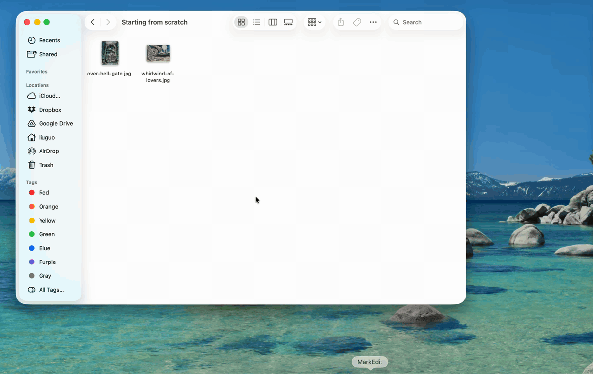

# moss

[](https://github.com/Symbiosis-Lab/moss/releases/latest) [](LICENSE) [](https://www.npmjs.com/package/@symbiosis-lab/moss)

**Write anywhere. Publish everywhere. Own everything.**

moss turns a folder of markdown into a website. The folder on your disk is the site: there is no database, no CMS and no project to configure. Write in any editor, and moss builds the pages, the navigation, the styling and dark mode, then publishes them. It is for writers, researchers, artists and small organisations who want a site they own, and for the coding agents that build sites for them.

This repository is the open-source engine, CLI, plugins and UI behind moss, wherever you write. To start, [install](#install) the CLI and run `moss build <folder> --serve` on a folder of markdown.



## Why moss

Your files stay on your computer. Your site lives on your domain. Your audience remains yours.

Like its namesake, moss thrives in the spaces others overlook. It doesn't compete with platforms for sunlight. It creates the foundation layer that enables an ecosystem: you publish to your own site first, and to the platforms your readers use second.

- **No setup.** Point moss at a folder. Sensible defaults stand in for a build config.
- **Any editor.** moss's own app, Obsidian, Typora, or anything else that saves markdown.
- **Media handled.** Images, video, HTML and Jupyter notebooks. Drop them in the folder.
- **Publish and syndicate.** To mosspub.com hosting (provided by Symbiosis Lab), or anywhere a deploy target or plugin reaches, then on to other platforms, with comments synced back.
- **Yours to extend.** CSS, JavaScript and plugins, with no generator config to learn.
- **Ready for coding agents.** `moss guide` and `moss describe` give an agent the conventions, the contract and the checks it needs to build a site correctly.

## Status

moss is in beta. Building, previewing and editing are open to everyone. You can publish to mosspub.com hosting with `moss deploy`. The built site is plain static files, so you can host it anywhere you choose.

## Install

Desktop app (macOS): download `moss.dmg` from [Releases](https://github.com/Symbiosis-Lab/moss/releases/latest), or run `moss desktop install` from an existing CLI install to fetch and verify it automatically.

macOS (desktop app + CLI, as a Homebrew cask):

```sh
brew install --cask symbiosis-lab/tap/moss
```

Linux (CLI only, x86_64):

```sh
brew install symbiosis-lab/tap/moss
```

Node.js (CLI only, macOS x64/arm64, Linux x64, or Windows x64):

```sh
npm install -g @symbiosis-lab/moss
```

`cargo install moss-cli` is coming — the crate is reserved on crates.io but not yet published.

## Quick start

Make a folder with an `index.md` in it, then:

```sh
moss build ~/blog/            # build once
moss build ~/blog/ --serve    # build and serve a local preview
moss list ~/blog/             # inventory every page: kind, URL, title, lang
moss env production ~/blog/  # publish this folder to mosspub.com
moss deploy ~/blog/ --site-id=my-blog --email you@example.com   # signs the folder in, then publishes my-blog.mosspub.com
moss deploy ~/blog/           # build and publish on every later run
```

`moss preview` and `moss edit` open a window and need the desktop app; the CLI binary hands off to it if installed, or tells you how to get it. Run `moss --help` for the full command list.

For a coding agent, `moss guide` prints the conventions and rules, and `moss describe --json` prints the whole contract: tokens, components, frontmatter and commands.

## Where moss is going

Designs for things moss does not do yet live in [docs/proposals](docs/proposals/), and those opened for public discussion link to an issue. A proposal is not a promise. The [`proposal` label](https://github.com/Symbiosis-Lab/moss/labels/proposal) lists the ones under discussion.

## Contributing

Bug reports, comments on proposals and pull requests are welcome. [CONTRIBUTING.md](CONTRIBUTING.md) says how to build, how to check a change and what we ask of contributors. Issues labelled [`good first issue`](https://github.com/Symbiosis-Lab/moss/labels/good%20first%20issue) are sized for a first contribution.

The desktop app's releases and bug reports live here too; its source is maintained separately.

## Repository layout

[ARCHITECTURE.md](ARCHITECTURE.md) says what each crate owns and where new code belongs.

| Path | What's there |
|---|---|
| `crates/moss-cli` | the `moss` CLI binary |
| `crates/moss-build` | the build engine every way of running moss calls |
| `crates/moss-core` | pure-Rust parsing and schema code, no I/O |
| `packages/moss` | the `@symbiosis-lab/moss` npm wrapper that installs the CLI binary |
| `packages/moss-api` | the plugin API |
| `packages/moss-ui` | [shared UI components and the typed engine contract](packages/moss-ui/README.md) used by moss hosts |
| `packages/moss-syntax` | shared markdown/frontmatter syntax tooling |
| `packages/obsidian-moss` | the Obsidian plugin |
| `site/` | the source of [mosspub.com](https://mosspub.com), including the docs |

## Documentation

Full docs: [mosspub.com/docs](https://mosspub.com/docs). Source: [site/docs/](site/docs/). Changes: [CHANGELOG.md](CHANGELOG.md).

## Issues

[Open an issue](https://github.com/Symbiosis-Lab/moss/issues) for the CLI, the build engine, any of the packages above, or the desktop app.

## License

[MIT](LICENSE)
