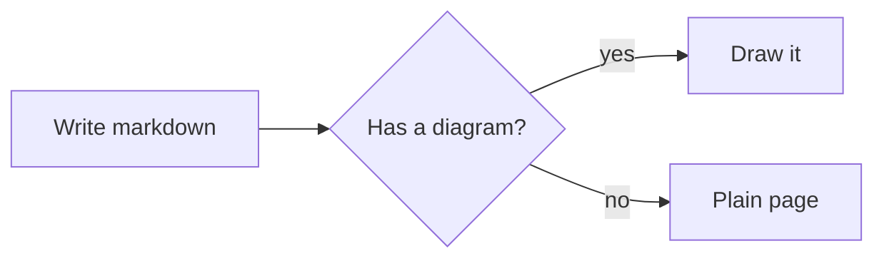

# Diagrams from Mermaid text

- **Status:** In progress. Option (a) was chosen: diagrams are drawn at build time in the QuickJS engine moss already ships, and the published page carries an SVG and no script.
- **Where the work would land:** all of it in this repository: the markdown renderer's code-block hook in `moss-core`, the renderer, sanitiser and site CSS in `moss-build`, and the tests beside them. The desktop app's preview shows the built page, so it needs nothing of its own.

## The problem

People who write in Obsidian, on GitHub or in GitLab draw diagrams as text: a fenced code block whose language is `mermaid`. All three show a drawing. moss shows the source as code, so a folder that reads well in Obsidian loses its diagrams the moment it is published. That is a floor defect by moss's own design rule: a folder written for those tools should build in moss and read the same.

## What we want

1. A fenced `mermaid` block (backticks or tildes) becomes a drawing on the published page, with no new syntax to learn.
2. The drawing is part of the HTML. A reader with JavaScript off, a search crawler and a screen reader get the diagram, not a script that might draw it later. Feeds and email are the exception for now; see below.
3. It looks like the rest of the site: the site's fonts and colours, light and dark, with no setting to change.
4. It reads on a phone. No label shrinks below a readable size; a diagram too wide for the screen scrolls inside its own frame, never the page.
5. A broken diagram never breaks the build. The page shows the source and a plain error naming the line, the build prints a warning, and `--strict` makes it fatal, as it does for other authoring mistakes.
6. Nothing in a diagram can run code, load a remote resource or reach outside its own frame.

## Authoring

Nothing moss-specific. Everything below is what Obsidian, GitHub and the Mermaid docs already accept, and it reads the same in those tools.

````markdown

````

- Every diagram type the renderer supports: flowchart, sequence, class, state, entity-relationship, gantt, pie, git graph, mindmap, timeline, journey, XY chart, quadrant, requirement, C4, sankey, block, packet, kanban, architecture, radar, treemap, and the newer beta types (agent flow, use case, railroad, tree view, Venn, Cynefin, Wardley, swimlane, Ishikawa, event modelling).
- `accTitle:` and `accDescr:` become the drawing's accessible name and description, as in Mermaid.
- A `---` front matter block inside the diagram with a `title:` draws the title.
- Obsidian's note links: `class A internal-link;` makes node `A` link to the note named by its label. moss resolves that name the way it resolves a `[[wikilink]]`, so the node links to the page's published address; a name that matches no page is drawn without a link and the build warns, as for an unresolved wikilink.
- `click A "https://example.com"` links a node to a web address. Only `http`, `https`, `mailto` and `tel` links are kept.

Not supported, by design: `click` callbacks (they would need script), images loaded from the web inside a diagram (a remote image on a static page is a tracking pixel), and `%%{init}%%` theme overrides beyond what the renderer itself honours, since the site theme sets the colours.

## How it renders: options measured

The renderer is [pele](https://pele.run/), an MIT-licensed Mermaid renderer with no dependencies that writes SVG themed with CSS variables and needs no DOM. It can run in three places. Each was prototyped and measured on the same real moss page, built with today's `moss build`: one page carrying one diagram of each of the 33 types, read in chromium and webkit at 375 and 1280 pixels wide, in light and dark, with JavaScript on and off. The scripts and the raw results are in [`measure/`](measure/).

| | (a) At build time, in the QuickJS engine moss already ships | (b) At build time, through Node when the machine has it | (c) In the reader's browser, as a site script |
|---|---|---|---|
| New Rust dependencies | none: `rquickjs` is already linked for plugins | none | none |
| Binary growth | 223 KB (the renderer, brotli-compressed, as the place map is embedded) | 0 | 734 KB more in every built site's assets, not the binary |
| Fixed cost per build | 62 ms to load the renderer, once per process, only when a page has a diagram | 50 ms to start Node, once per build | 0 |
| Cost per diagram | 0.2 to 1.7 ms (median 0.6) | 0.2 to 9 ms, first call slowest | 0 at build; 5 to 15 ms per diagram on the reader's main thread |
| Worst legal diagram (5,000 edges) | 663 ms | 87 ms | same work as (b), on the reader's device |
| Page weight added (33 diagrams, brotli) | 12.8 KB, 0.39 KB per diagram | same as (a) | 224 KB of script, plus layout shift (CLS 0.04 on a phone) |
| JavaScript off | the diagrams | the diagrams | the source code |
| Same output on every machine | yes | only where Node and the same renderer version are installed; the desktop app ships no Node, and a Mac app opened from Finder does not see a terminal's PATH | yes, once loaded |
| Time limit per diagram | yes: QuickJS's interrupt handler stops a render at a budget and the engine carries on (tested at 100 ms) | needs a worker process | none |

Two facts settle most of the comparison. First, (a) and (b) produce the same bytes: all 33 corpus diagrams rendered byte-identical in QuickJS and in Node, so choosing (a) gives up no fidelity. Second, (b) is (a) with a worse runtime story: its output depends on what the building machine has installed, and pinning the renderer to fix that means vendoring it, at which point the only difference left is a runtime moss does not control.

The recommendation was (a), and it is the option being built.

### Phones: four shapes measured

A diagram drawn for a desktop column shrinks on a phone. At 375 pixels a plain scaled SVG drew text as small as 3.2 px, with 16 of 33 diagrams under 11 px. Four static shapes were measured, all without JavaScript:

| Shape | Smallest text at 375 px | Diagrams under 11 px | Diagrams that scroll in their frame | Page scrolls sideways |
|---|---|---|---|---|
| Scale to fit | 3.2 px | 16 | 0 | no |
| A wide and a narrow layout, switched by a container query at 640 px | 6.5 px | 7 | 0 | no |
| Natural size, scroll in the frame | 10 px | 1 | 23 | no |
| **Wide and narrow layouts, each allowed to shrink only until its smallest text reaches 11 px, then scroll** | **10 px** | **2** | **7** | **no** |
| (c) in the browser, for comparison | 6.5 px | 4 | 0 | no |

The two at 10 px in the recommended shape are packet and sankey, which the renderer draws at 10 px in the first place; moss never shrinks them. The narrow layout is the renderer's own: told it has 360 pixels, it redraws a left-to-right flowchart top to bottom, wraps a timeline, and so on, exactly what its in-browser mode does under 640 pixels. The bounded shrink is one CSS rule per drawing, `width: min(W, max(100%, s·W))`, where `W` is the drawing's natural width and `s` is the smallest scale that keeps its smallest text at 11 px; the build reads both from the SVG it just made. The page carries both layouts and the hidden one is `display: none`, so a screen reader meets one drawing.

## Theming

The renderer reads its colours from `--pele-*` custom properties. moss sets them from its own tokens once, in the site stylesheet, so a diagram follows the site and its dark mode without being redrawn:

| Renderer variable | moss token |
|---|---|
| `--pele-bg` | `--moss-color-bg` |
| `--pele-fg` | `--moss-color-text` |
| `--pele-muted` | `--moss-color-muted` |
| `--pele-line` | `--moss-color-text-secondary` |
| `--pele-surface` | `--moss-color-surface` |
| `--pele-surface-alt` | `--moss-border-light` |
| `--pele-border` | `--moss-border-strong` |
| `--pele-accent` | `--moss-color-accent` |
| `--pele-font`, `--pele-font-mono` | the site's body and code fonts |
| `--pele-series-1` … `-8` | a moss chart palette, new tokens with light and dark values |

The chart palette is needed because the renderer's own eight series colours fail the 3:1 contrast that WCAG asks of graphics on moss's light background (four of eight: 1.51 to 2.98). On the dark background all eight pass. The renderer draws some labels in the page colour on top of a series colour (pie slices, timeline and gantt bars, treemap cells), so each series colour has to reach the text ratio, 4.5:1, against the page colour, not just the 3:1 asked of marks. The render gate below found this on its first run. The proposed palette, in series order (blue, rust, teal, red, violet, ochre, magenta, green):

| Series | 1 | 2 | 3 | 4 | 5 | 6 | 7 | 8 |
|---|---|---|---|---|---|---|---|---|
| Light | `#046bd0` | `#c24100` | `#007c59` | `#d81428` | `#824ae4` | `#8f6504` | `#ca1d87` | `#257d04` |
| Dark | `#1588ff` | `#f05400` | `#00a995` | `#fb4345` | `#9c6cff` | `#b98400` | `#ec46a4` | `#33ab00` |

Every colour reaches 4.6:1 against both the page background and the surface colour in its mode. Neighbouring series stay apart for readers with each common colour-vision deficiency (worst neighbouring pair: ΔE 10.1 in OKLab×100 light, 12.1 dark, above the usual target of 8) and for full-colour readers (worst 24.7 light, 25.7 dark, above the floor of 15). A theme can override any of these properties like any other token.

The box sizes are fixed at build time, from the renderer's built-in table of character widths, before the reader's font is known. The render gates below check that every label still fits its shape in the site's real fonts, in both engines.

## Accessibility

- The SVG carries `role="graphics-document document"` and the diagram type as `aria-roledescription`. With `accTitle`/`accDescr` it gets a `<title>` and `<desc>` wired with `aria-labelledby`/`aria-describedby`. Without them, moss names the drawing by its front matter title if there is one, else by its type ("Flowchart"), so it is never an unnamed graphic.
- Every label is real SVG text, so it can be selected, searched and read aloud. A check compares the text in the drawing with the renderer's own parse of the source, so no node or edge label is lost.
- A frame that scrolls is focusable (`tabindex="0"`), as moss's code blocks already are, so it can be scrolled from the keyboard. A linked node is a real link and takes focus in reading order.
- Contrast: text, lines and borders are checked against their backdrop in both themes (4.5:1 for text, 3:1 for lines, borders and chart marks).

## When a diagram is wrong

A diagram that does not parse, names an unknown type, exceeds a limit or runs past its time budget is replaced by what moss shows today, the source in a code block, with one line above it: "This diagram could not be drawn: line 3, expected `end`." The line is plain text. The build prints the same message with the file and line, and `--strict` turns it into an error. The page, the rest of the site and the publish carry on.

Limits are moss's own and sit under the renderer's: source length, edge count, output size, and a time budget per diagram. A diagram over a limit fails the same way, with the limit named.

## Safety

The renderer escapes diagram text, drops `click` callbacks and refuses `javascript:`, `data:` and `vbscript:` links. moss does not rely on that alone, because the renderer releases often and a regression would ship silently. Every SVG passes through a sanitiser in `moss-build` that parses it and keeps only an allowlist of SVG elements and attributes: no `<script>`, no `<foreignObject>`, no event-handler attributes, no `<style>` elements, no `url()` pointing outside the document, no link outside the allowed schemes. Anything outside the list fails the diagram closed, to the code-block fallback, rather than being repaired. Images are switched off in the renderer, and the render options are fixed by moss, never taken from the diagram.

## Feeds and email

A feed item carries the drawing's wide layout only, since a feed reader cannot choose between layouts. Many feed readers and every common mail client strip inline SVG, so for them the diagram is not there yet. The next step is the projection math already has: a hosted PNG of each drawing, with the page's colours resolved, linked from the item. The site search indexes the wide layout only (`data-pagefind-ignore` on the narrow one), so a label is not counted twice.

## The desktop preview

The preview serves the same build output, through the same page renderer, so it shows exactly what will be published. The editor keeps showing the source, as it does for every other block. Drawings are not cached: one layout takes about a millisecond in a release build, and the engine loads once per process (about 60 ms), which the preview process keeps alive between rebuilds. A cache keyed by the source and the renderer version is the step to take if diagram time ever shows up in a build's timing.

## How it is tested

Every check reports pass, fail or inconclusive. Inconclusive never counts as a pass, and the summary prints the three counts.

1. **Corpus.** One diagram of every supported type, malformed sources (empty, no type, unclosed blocks, bad dates), and adversarial ones: injection attempts in labels, links, styles, directives, front matter and accessible titles; huge graphs at and past the edge limit; deep nesting; long runs of punctuation; CJK, Arabic, Hebrew, emoji, combining marks and zero-width characters. Generated stress inputs are built by the test, not checked in.
2. **Golden SVGs.** Each corpus diagram's output is stored and compared byte for byte. The renderer's version and the clock it is given are pinned, so the output is deterministic; the goldens change only when regenerated on purpose, with the same `SNAPSHOTS=overwrite` switch the build snapshots use.
3. **Sanitiser.** Every output, valid and adversarial, is parsed and checked against the allowlist. The adversarial corpus must produce zero escapes, and a planted bad SVG must be refused, so the check is proven able to fail.
4. **No text lost.** The node and edge labels the renderer's own `parse()` reports are compared with the text in the drawing. A label missing from the drawing fails.
5. **Render gates.** In chromium and webkit, at 375 and 1280 pixels, light and dark: no page-level sideways scroll, no label outside its shape (with each type's labels that sit outside by design named), smallest text at or above the floor, and contrast for text, lines and chart marks.
6. **No JavaScript.** The same page with JavaScript off shows every diagram.
7. **Accessibility.** Every drawing has an accessible name; scrolling frames are focusable; axe finds no violations in the diagram markup.
8. **Budgets.** Build time per diagram and page weight per diagram have ceilings; a renderer upgrade that blows one fails.
9. **Real folders.** The whole suite runs against copies of real sites and Obsidian-style folders with diagrams in them.
