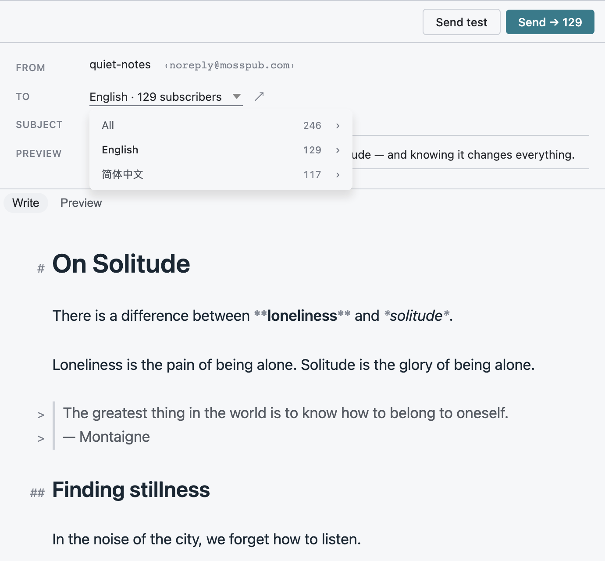
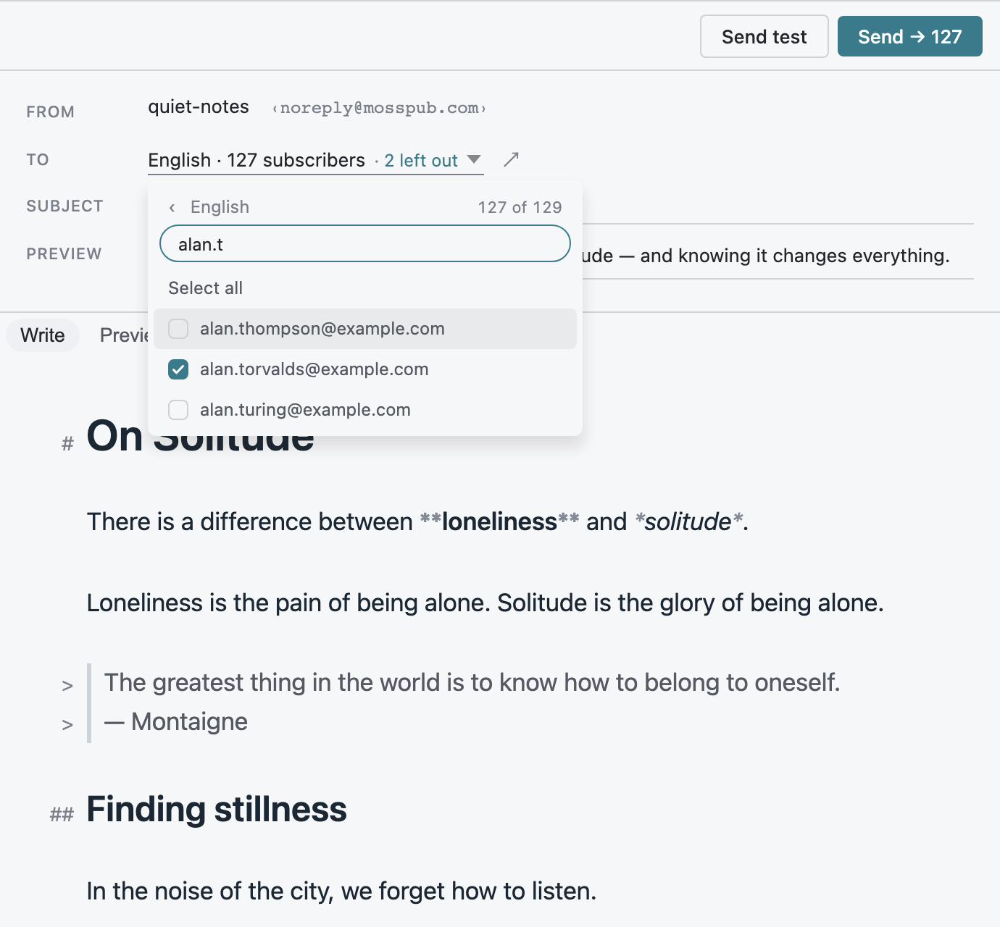
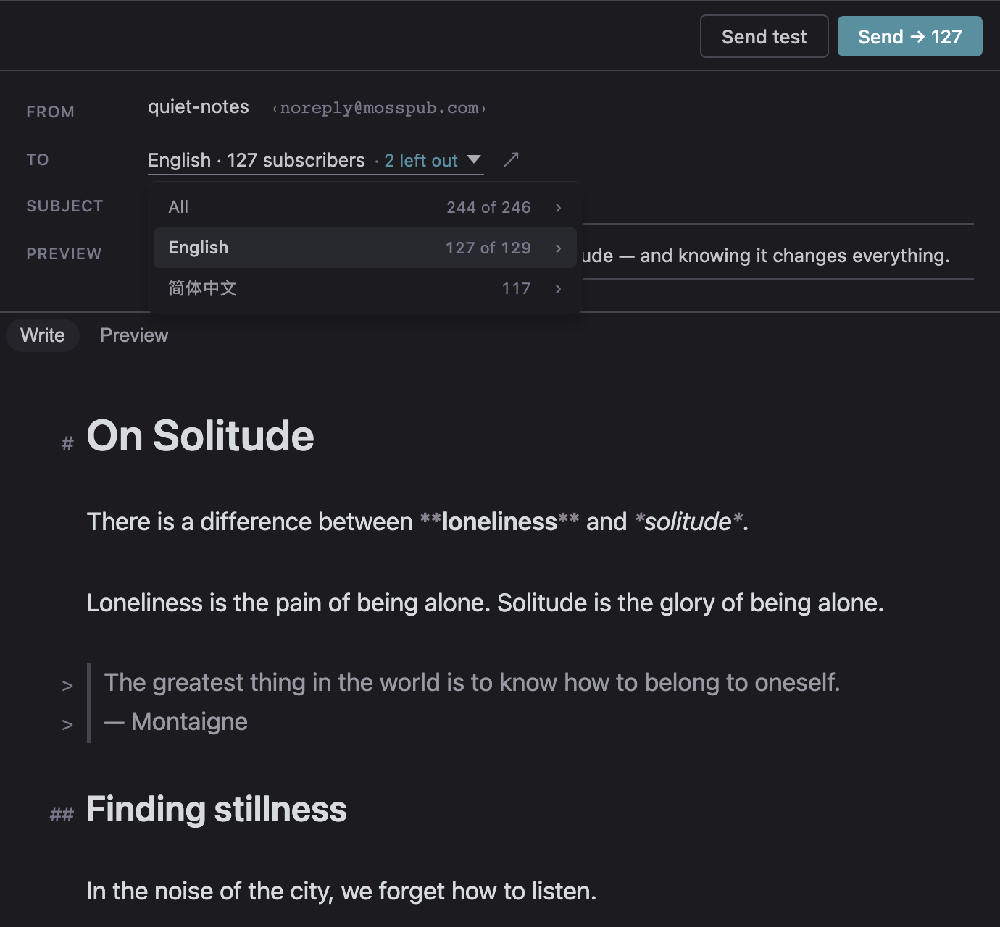
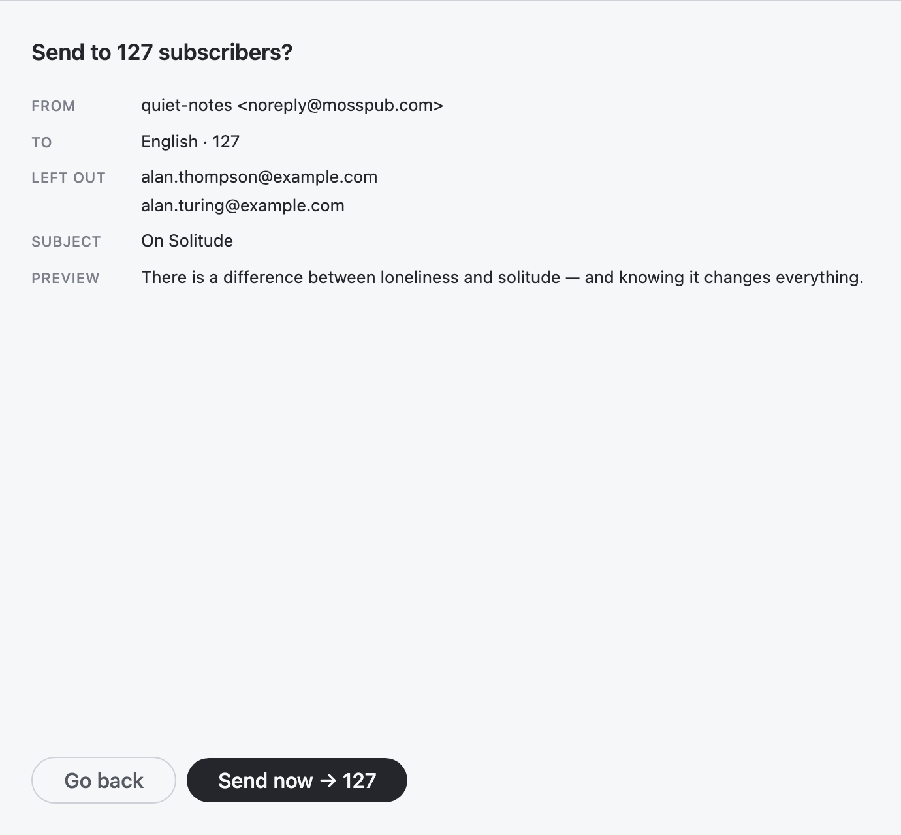

# Leave specific subscribers out of one newsletter send

- **Status:** In progress. Designed and prototyped in October 2026, revised the same month so that leaving people out lives inside the audience menu, and accepted for building.
- **Discussion:** [issue #31](https://github.com/Symbiosis-Lab/moss/issues/31)
- **Where the work would land:** the email composer in the desktop app, and the send service that resolves the audience and dispatches the mail.

## The problem

When moss sends an article as a newsletter, the audience is chosen by scope: everyone, or one language section. There is no way to say "everyone except these two people". Writers have good reasons to need it for a single article: the piece is about someone on the list, a subscriber is a colleague who has already seen a draft, a reader asked to skip this topic without leaving the list. Today the only options are to send to everyone, to unsubscribe the person (which also drops them from every later send), or to not send the newsletter at all.

The owner's constraint is that this must be simple and intuitive for a writer with a few hundred subscribers. It is not a segmentation engine.

## Decision: per send, not a persistent flag

**Exclusion is a per-send choice.** The writer picks the people to leave out while composing, and the choice applies to that one send. A persistent per-subscriber "do not email" flag is not part of this proposal.

**A persistent flag already exists.** Unsubscribing, or removing an address from the Subscribers list, is the persistent "stop emailing this person" control. A second hidden flag would be a third state for a subscriber (subscribed, unsubscribed, subscribed but silently skipped), and the third one is a trap: the person believes they are on the list, the writer forgot the flag, and mail never arrives. A per-send list cannot do that, because it is visible at the moment of sending and gone afterwards.

**The need is about an article, not about a person.** Every reason in the problem section is true for one piece and false for the next. A per-send list matches that, and it needs no new screen outside the composer.

**Both is deferred, not refused.** If writers later ask for "pause this person for a month", that is a different feature with its own expiry and its own place in the Subscribers settings. It is listed under open questions.

Prior art points the same way. The products that offer exclusion at all offer it per send (Mailchimp, Kit, Beehiiv). The tag and segment route exists in all of them, but it asks the writer to build a group first, which is the segmentation engine this proposal avoids. Listmonk's maintainer declined per-send exclusion and recommends sending to a temporary list built to omit the person, which is the same workaround in a less friendly form.

## Prior art

Each source below was read on the vendor's own page unless marked.

- **Mailchimp:** a "Do not send to" drop-down in the To section of the email checklist, taking segments or tags (up to 10), plus an option to exclude pasted email addresses. No recipient count on the review step is documented. [Create and send a regular email](https://mailchimp.com/help/create-and-send-regular-email/), [Send to a segment](https://mailchimp.com/help/create-and-send-to-a-segment/).
- **Kit (ConvertKit):** a filter group set to "Matching none" on the broadcast's recipients setting. The recipient count updates as filters are added (the help article's example drops from 37 to 14). [How to exclude certain subscribers from a broadcast](https://help.kit.com/en/articles/2502648-how-to-exclude-certain-subscribers-from-a-broadcast).
- **Beehiiv:** an "Include and exclude segments" control on the Audience step of the post flow (up to 5 segments combined), with the total recipient count shown at the top. Unsubscribed and suppressed addresses are dropped at send time automatically. [Audience page options](https://www.beehiiv.com/support/article/13064033042199-options-on-the-audience-page-of-the-post-flow), [Suppression list](https://www.beehiiv.com/support/article/39295580451095-understanding-your-suppression-list).
- **Ghost:** include-only. The publish menu chooses recipients by newsletter, access level or label, with no documented exclusion. [Email newsletters](https://ghost.org/help/email-newsletters/).
- **Buttondown:** the audience is everyone or certain tags; no per-send exclusion on the page read. [Sending emails](https://docs.buttondown.com/sending-emails).
- **Substack:** the publish settings let a post go to a saved segment. This is taken from search-result snippets only, because the help pages refused automated fetches, so treat it as unverified. [Subscriber segments](https://support.substack.com/hc/en-us/articles/52113249525140-What-are-subscriber-segments-on-Substack).
- **Listmonk:** per-send exclusion declined by the maintainer, with a temporary list as the workaround. [Issue 2785](https://github.com/knadh/listmonk/issues/2785).

What none of them documents is the confirmation step naming the people who were left out. That is the part this design adds, because a send cannot be undone.

## Prior art for the control

The question here is how to put a second level, a checklist of people, under the audience list inside a 480 to 690 pixel panel. Three patterns exist: a cascading flyout beside the parent row, a drill-in that replaces the list inside the same popover under a back header, and an inline expand under the row. The sources below were read on their own pages; Apple's and Material's menu guidance returned only page titles when fetched, so neither is cited as evidence.

- **Flyouts are error-prone with a mouse.** Nielsen Norman Group: "Hierarchical (or cascading) dropdown menus are error-prone, require precise mouse movements" ([the 3-click rule](https://www.nngroup.com/articles/3-click-rule/)), and a plain dropdown "becomes frustrating with two tiers" ([menu design checklist](https://www.nngroup.com/articles/menu-design/)). The usual repairs, a delay or a "safe triangle" under the pointer, are explained by [Ben Kamens](https://bjk5.com/post/44698559168/breaking-down-amazons-mega-dropdown), [React Aria](https://react-aria.adobe.com/blog/creating-a-pointer-friendly-submenu-experience) and [Smashing Magazine](https://www.smashingmagazine.com/2023/08/better-context-menus-safe-triangles/). A flyout also needs room beside its parent, which a 480 pixel panel does not have; no source gives a width budget for that case.
- **Drill-in has no pointer problem and uses the full width.** The second level replaces the first, so there is no diagonal path to get wrong. Nielsen Norman Group warns that the Back link of such sequential menus "can be confused with the browser's Back button" and that they "generally do not recommend them for subnavigation" ([mobile subnavigation](https://www.nngroup.com/articles/mobile-subnavigation/)); that is advice about site navigation, and the mitigation it implies, a back row that names the parent, is what this design does.
- **Inline expand is the best fit for short second levels.** The same article recommends accordions, and says submenus "work well when they contain just a few subcategories (typically less than 6)". A list of a few hundred people is far past that in every pattern, so the second level needs its own filter whichever way it opens.
- **Keyboard.** The WAI-ARIA menu pattern gives Right Arrow to open a submenu and Left Arrow to close it and return focus to the parent, and says a checkbox item "changes the state without closing the menu" ([menu](https://www.w3.org/WAI/ARIA/apg/patterns/menu/), [menubar](https://www.w3.org/WAI/ARIA/apg/patterns/menubar/)). A checklist inside a menu therefore uses the `menuitemcheckbox` role. The tree-view pattern is the closest standard for inline expand ([tree view](https://www.w3.org/WAI/ARIA/apg/patterns/treeview/)). The drill-in's push-and-back is not defined by either pattern, so its keys are this design's to define; they follow the menu pattern and are listed below.
- **Select all and filter.** GitHub's Primer design system has the one fetched precedent for both inside a multi-select panel: a "Select all" that acts on "visible items", and a filter input ([SelectPanel](https://primer.style/product/components/select-panel/)). Radix offers the same split in code, a submenu trigger and a checkbox item as separate parts ([dropdown menu](https://www.radix-ui.com/primitives/docs/components/dropdown-menu)).
- **What no source covers.** None of the fetched products or pattern pages shows a default-on exclusion checklist or an "N of M" count on the parent row. Both are open design choices here, justified below rather than borrowed.

## The flow

1. **The TO row has one control, the audience pill.** There is no separate "Leave out" button. The pill reads "English · 129 subscribers" with a caret, and the Subscribers link stays beside it. Nothing else in the composer changes, and nothing is added to the titlebar. [Light](./01-composer-light.png) · [dark](./01-composer-dark.png)
2. **The pill opens the audience menu.** One row per audience: All, then each language, each with its subscriber count and a right chevron. Clicking the row, or pressing Enter on it, chooses that audience and closes the menu. Clicking the chevron, or pressing Right Arrow, opens the people in that audience. [Light](./02-to-menu-light.png) · [dark](./02-to-menu-dark.png)
3. **The second level is a checklist.** The menu list is replaced in place by one checkbox row per person, all ticked, under a back header that names the audience ("‹ English") and carries the count. Past eight people a filter field sits directly under the header, focused, with a blinking caret and the placeholder "Type to filter". [Light](./03-drilled-in-light.png) · [dark](./03-drilled-in-dark.png)
4. **Unticking leaves a person out.** The menu stays open while the writer unticks as many people as needed. The header turns to "127 of 129", a **Select all** row appears at the top of the list (it is absent while everyone is ticked), and the pill, the Send button and the audience row all follow at once. There is no Apply or Done. [Light](./04-two-unticked-light.png) · [dark](./04-two-unticked-dark.png)
5. **Back at the audience menu the result is compact.** The English row reads "127 of 129", and the rows that are untouched read just their count. After the menu closes, the pill reads "English · 127 subscribers · 2 left out" and Send reads "Send → 127". One count feeds all of them. [Light](./05-back-at-menu-light.png) · [dark](./05-back-at-menu-dark.png)
6. **The confirmation names them.** The existing send confirmation shows "Send to 127 subscribers?", the audience, and a **Left out** row with the addresses (the first five, then "and N more"). The writer reads who is skipped at the moment it can still be changed. [Light](./06-confirm-light.png) · [dark](./06-confirm-dark.png)

The screens are 690 pixels wide, the width of the desktop app's side panel, built on the real composer with stubbed data: 252 synthetic addresses at example.com, 129 of them deliverable English subscribers. The sender stays the product's own noreply address. Nothing is sent from the prototype.

## Design decisions

**How the second level opens: drill-in, not a flyout and not an inline expand.** The app's design rules already forbid cascading flyouts, and the shared menu already drills in place (the create menu's template manager is one). So the second level replaces the list in the same popover under a back header, at the same width, with no pointer path to get wrong. Inline expand was considered seriously and rejected for this audience: 129 rows open under one audience row push the other audiences out of the panel, so the expanded rows need a scroll box of their own inside a menu that already scrolls, and two nested scrollers in a 480 pixel panel is the worst place for it. Only one audience's people are useful at a time, so the context an accordion keeps in view is the context the writer does not need; and the back header gives the count, the filter hint and Select all one stable place to live. The price is one extra click to compare two audiences, which the "127 of 129" on the first level mostly removes.

**One component, not two.** The second level is a new row kind in the shared menu, a checkbox row (`role="menuitemcheckbox"`, `aria-checked`), not a second popover. The earlier prototype hand-rolled its own popover and its own outside-click handling and had no arrow keys. Moving onto the shared menu deletes that popover and gives the control the menu's roving focus, dismissal and focus return for free. The shared menu gained four small things for this: the checkbox row; a "two-target" submenu row (the row chooses, the chevron drills in); levels that re-read live state when they repaint, so counts and ticks stay true after a toggle or a Back; and type-to-filter.

**The two-target row is a deliberate exception.** On an ordinary drill-in row Enter opens the next level. On an audience row Enter chooses the audience, because choosing the audience is the thing the row is for and the common case; only the chevron and Right Arrow drill in. This is the one place the owner's "arrow expands further" and "the row picks the audience" pull apart, and splitting the targets keeps both as one click.

**Keys.** The menu's existing keys, with two additions.

| Key | Effect |
|---|---|
| Up, Down | Move the active row, wrapping; in a filter field, focus stays in the field and the row is named by `aria-activedescendant` |
| Home, End, Left, Right | Move through the rows (Home, End) or drill (Right, Left) in a level with no field; in the filter field they move the caret |
| Right | On a row with a chevron, open its people |
| Enter or Space | Audience row: choose and close. Checkbox: tick or untick, menu stays open. Back row: go back. Select all: restore everyone |
| Left | Back one level; does nothing at the first level |
| Escape | In the filter field, clear the text first; then back one level; at the first level, close the menu and return focus to the pill |
| Any letter, digit or punctuation | Typed into the filter field (focus is already there), narrowing the list to matching addresses |
| Backspace | Edit the filter text |
| Tab | Close the menu |

**A real filter field, only where the list is long.** Past eight people the level has a text field that holds focus, because a bare "Type to filter" line looked like a field with no caret and gave no sign that typing worked. This is the combobox pattern used by GitHub's and Linear's pickers: the input is a `combobox` controlling the list, DOM focus never leaves it, and the arrow keys move an active row that the input names through `aria-activedescendant`. Space and Enter toggle the active row (addresses contain no spaces), Left and Right move the caret, and Escape clears the text before it goes back a level. The app's design rules say a menu with a text field is a combobox, not a plain menu, so only the levels that need typing take on those roles; every other menu keeps roving focus. The field shares one header block with the back row, with no rule or gap between them. With eight people or fewer the whole list fits, so there is no field, but typing still filters, and the query shows on a line only while it is non-empty.

**Level two contents.** From top: the back header with the audience name and "127 of 129" (just "129" while everyone is ticked); the filter field when the list has more than eight people; **Select all** only while someone is unticked; then one row per person, sorted by address, all ticked. Select all restores everyone in that audience, not only the people matching the filter: a change that silently skips people hidden by a filter is worse than one that does too much, and it is a single click to undo. The All audience lists everyone and shows each person's language as muted text on the row, because otherwise two rows from different languages look alike.

**Addresses first.** A subscriber has no name today, only an address, so the address is the row's text. If names are added later the name becomes the row and the address its muted detail, and the filter already matches both.

**Level one contents.** One row per audience, with its count, a chevron, and a current-choice mark on the audience the send goes to. A fully ticked audience reads its count ("129"); one with people left out reads "127 of 129". An audience nobody is in reads "0" and has no chevron, because there is nothing to open.

**The count on the pill and the Send button is the net count.** The pill reads "English · 127 subscribers · 2 left out" so a hidden exclusion is never silent, and Send reads "Send → 127". The confirmation keeps naming who is left out.

**Rules carried over from the first design, and what changed.** Test sends still go to the sender alone and never carry a left-out list; the old footer line saying so is dropped because a test send reaches only the sender, so the list is irrelevant to it. Scope behaves as before except for one consequence of the new structure: a person can now be unticked while looking at an audience the send is not going to, and that exclusion stays dormant, not counted by the pill or Send, until the writer chooses that audience or All; the audience's own row does show it ("116 of 117"). Unsubscribes, re-subscribes, the audience being resolved at send time and the send record are unchanged.

## Edge cases

**Count.** One function computes the number everyone shows: deliverable subscribers in the chosen scope, minus the left-out addresses that are themselves deliverable and in scope. The Send button, its accessible label, the audience pill, the rows of the audience menu, the confirmation heading and the confirmation's per-language rows all read it, so they cannot disagree. Building the prototype showed the existing confirmation does disagree today: choosing All and opening the confirmation uses the article's own language count rather than the All count. This was found by reading the code, and the single function removes the case.

**Everyone left out.** If the net count is zero, Send is disabled and the strip under the header says "Everyone is left out of this send." This is a different message from "No confirmed subscribers in this scope", which would be wrong here.

**Test sends.** Send test goes to the sender's own address and ignores the list. A test send never carries an exclusion, and the send service rejects one if it arrives.

**Scope-targeted sends.** Each audience's list shows only the people who would receive a send to that audience. The left-out set is kept as addresses, not tied to a scope: a person left out of the English list who is not in the Chinese section is dormant while that section is selected, does not count there, and applies again if the writer switches back or to All. The "2 left out" suffix on the pill always counts only the people it applies to.

**A left-out person who unsubscribes.** Nothing special. The send service resolves the audience at the moment of sending, and an address that has unsubscribed, bounced or complained is not deliverable, so it is not in the audience and is not counted as left out. The record keeps only the people who would otherwise have received the send.

**A left-out person who re-subscribes.** The exclusion belongs to one send and nothing remembers it afterwards. If they re-subscribe before the writer sends, they are still left out of that send, because the list holds addresses. After the send they receive the next one like anyone else.

**Closing the composer.** The prototype keeps the list for the session, which would silently undo it when the composer is closed and reopened. The proposal is to store the list in the draft with the subject and body, and when the draft is reopened to drop addresses that are no longer subscribers. This is the first open question.

**What the send record stores.** The send log keeps one record per send today (article, audience, recipient count, time). It gains the list of left-out addresses that applied and the audience size before exclusion, so "129 in the audience, 2 left out, 127 sent" can be reconstructed later and a resend or a complaint ("why did I not get this?") can be answered. These addresses are the writer's own record and are never shown to subscribers.

## Where the list is resolved

**The desktop app chooses; the send service applies.** The app knows the subscriber list it already shows and lets the writer pick addresses. It sends those addresses with the request. The service resolves the audience from its own subscriber data at send time and subtracts the list, so deliverability, unsubscribes and scope are decided in one place, and the count it returns is the truth. The app's count is a preview of the same arithmetic.

**The alternative, resolving the recipient list on the device and sending it whole,** would put a few hundred addresses in every request and make the service trust a list that may be minutes stale: someone who unsubscribed in between would still be mailed. The service would have to re-filter anyway, which is the arithmetic above.

**The alternative, storing exclusions on the server per article,** adds state that has to be created, edited and cleaned up, for something that lives for one composing session.

**The failure that must be designed out.** The current send service ignores request fields it does not know. A new app sending an extra `exclude` field to a service that has not been updated would send to everyone, including the people the writer chose to skip, and nothing would say so. The exclusion therefore travels inside the audience as a new kind, for example `{ "type": "except", "of": { "type": "scope", "value": "en" }, "emails": [...] }`. A service that does not know the kind rejects the request ("audience required") and sends nothing. The server ships first; the app also checks that the service supports the kind before it offers the control.

## Implementation sketch

**Desktop.**

- One function, net audience, replaces the three places that compute a count today.
- The composer keeps a set of lower-cased addresses, saved with the draft.
- The audience pill replaces the language drop-down and the earlier popover. It opens the app's shared menu, which gains a checkbox row, a two-target submenu row, levels that re-read live state, and type-to-filter. Nothing is built as a second popover.
- The Send request wraps the locked audience in the new kind when the set is non-empty.
- The confirmation reads the same net result and prints the Left out row.
- Strings go in all three UI languages.

**Send service.**

- Accept the new audience kind, rejecting it when the base is a test audience.
- Resolve the base audience, then drop the listed addresses (case-insensitive) and return the real recipient count.
- Write the addresses that applied and the pre-exclusion size into the send record, and return both in the response.
- An empty result after subtraction sends nothing and writes no record, as an empty audience does today.

**Tests that would matter.**

- An old-shape request still works, and an `except` request to a service without the kind fails closed.
- An unsubscribed address in the list is not counted as left out.
- A left-out address in a legacy (pre-scope) row is left out in every scope.
- The count shown in the composer equals the count the service returns.
- In the menu: a checkbox row toggles on Space and click without closing the menu, Enter on an audience row chooses, Right and the chevron drill in, Left and Escape go back, and typing narrows the list.

## Related menus in moss

The audience menu now uses the app's shared menu component, the one that already drills in place for the create menu's template manager. Its new checkbox rows, two-target rows, live levels and type-to-filter are generic and are meant to be reused.

Two other places hand-roll the same kind of dropdown and should move onto it later: the deploy host picker in the publishing settings, and the domain picker beside it. They duplicate each other's markup and styling, and their keyboard handling has drifted apart: the host picker closes on Escape only and has no arrow keys, while the domain picker has arrows and Enter. A single shared menu would give both the full keyboard model and delete one of the two implementations. The domain picker's inline confirm row and grouped sections would need a place in the shared menu first, so this is a follow-up and is not part of this proposal; nothing outside the composer is touched. It is tracked as its own issue.

## Decided

- **The list is kept in the draft**, with the subject and body, so closing and reopening the composer does not silently undo it. Addresses that are no longer subscribers are dropped when the draft is reopened, and the confirmation names everyone left out, which is the safeguard against a forgotten list.
- **Opening another audience's people does not choose that audience.** An exclusion made there waits until that audience is chosen, so browsing never changes who receives the send.
- **Enter on an audience row chooses it; only the chevron and Right Arrow open its people.** The two-target row stays as designed.

## Open questions

- **A persistent "pause"?** If writers ask to skip someone for a while, it belongs in the Subscribers settings with an expiry, not in the composer. Wait for evidence.
- **Wording.** "Left out" reads gentler than "Excluded". Is it the right word in the app's other languages?
- **Subscribers have no names today.** The list shows addresses only. If names are added, the name leads the row and the search matches both.
- **Send to the people left out, later.** A natural follow-up is "send this to the 2 I left out" after the fact. Not designed here.
- **Anywhere else this should show?** The Subscribers list could mark a person as left out of a recent send. Not proposed.
