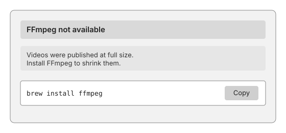
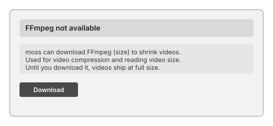

# Offer missing tools with a Download button

- **Status:** In progress. The build offers the download, and `moss tools download` fetches the tool. The desktop app's Download button is built from a private repository.
- **Where the work would land:** the binary resolver, the advisory model and the build's advisory output in this repository. The advisory card and its Download button are in the desktop app, which is built from a private repository.

## The problem

moss runs a few command-line tools while it builds. FFmpeg and ffprobe make video smaller and read its dimensions, git reads a site's history, and some plugins need their own runtime. When one of them is not already on the machine, moss downloads its own copy. Today that download is silent, and it comes from a third-party address that always points at the latest release and publishes no checksum. One of those addresses has since been removed by its host, so the download fails on every build.

Finding an installed tool is unreliable too. A Mac app opened from Finder does not inherit the PATH of a terminal. Homebrew installs into `/opt/homebrew/bin`, which moss does not search, so a tool the person already has is reported as missing. The card then tells them to run `brew install ffmpeg`, which is the wrong advice for someone who has already done that.

## What we want

1. moss finds tools that are already installed. Before it reports one missing, it also looks in `/opt/homebrew/bin`, `/usr/local/bin` and `/opt/local/bin`, the directories Homebrew and MacPorts install command-line tools into.
2. moss never downloads an executable without the person's yes. A build does not fetch anything on its own.
3. When a tool is missing, the advisory card that already reports it offers the download. The offer says what moss will use the tool for and how large the download is, and it has one button, Download. There is no "Not now" button and no remembered refusal. Until the person presses Download, the build ships without the tool, so videos ship at full size, and the card stays on screen like any other advisory.
4. The command-line tool is `moss tools download <tool>`. Running it is the consent, so it fetches without a second question, and a build never fetches on its own. The build's advisory output prints that command, so a terminal user and an agent read the same instruction.
5. The download comes only from builds that moss publishes on its own GitHub releases. Each build is pinned to a version and verified by SHA-256. The build's source code, its build script and its license are published on the same release.

## The card, before and after

Today the card names the missing tool and offers a command the person copies into a terminal. The command is the only thing it can offer, and it fails for the person who already has the tool in Homebrew's directory.

With this proposal the same card, in the same place, offers the download. The text says what the tool is for and how big the download is. The button starts the download, and nothing else on the card changes.

## Design

### The offer is a condition of the build

Non-acknowledged advisories describe a condition of the current build. A rebuild derives them again, and the panel clears them when a build starts. A missing tool is that kind of condition, so the offer uses the ordinary advisory kind rather than the sticky `Acknowledge` action. It returns on every build until the tool is installed or the person presses Download. Its severity is `ShippedDegraded`, the same level a video published at full size already uses: the site shipped, and it is not as good as it could be.

The action is `Action::InApp` with a new `AppOp::DownloadTool`. Its arguments name the tool. The button label is Download. Adding this variant changes the closed `AppOp` set, so the generated bindings for the desktop app are regenerated in the same change. `AppOp` says that the build emits only `None` and `Command` today. This would be the first `InApp` action the build emits.

### Resolution order

Today the resolver runs configured path, then PATH, then the `~/.moss/bin` cache, then download. The proposed order is configured path, then PATH, then the Homebrew and MacPorts directories, then the cache, and then the offer. The offer replaces the download step. Once the person says yes, the download runs through the code that already exists: the archive is fetched, its SHA-256 is checked, and it is extracted into a temporary directory and renamed into place. Only the trigger moves. The download runs only through `download_tool`, after the person says yes. A cached copy that fails its version check is still deleted, and the resolver then offers the download again.

The configured path keeps its meaning and still wins over everything else.

### Saying yes

In the desktop app, Download starts the download with a progress indicator. When it finishes, the app starts a rebuild so the videos are processed at once.

On the command line, `moss tools download <ffmpeg|git>` is the consent: running it fetches the tool. The build's advisory output prints the same command as `run: moss tools download ffmpeg`. A plugin asks for the same download through its task's awaiting state, with the escape `download-tool:<name>`, and gets the same single Download button.

Nothing is downloaded when the app starts, when a site is opened, or when a preview is served.

### What the download is

A download is a build that moss publishes on a moss GitHub release, one per tool, version and platform. FFmpeg and ffprobe come from the `ffmpeg-<version>-moss.<n>` releases built by `.github/workflows/ffmpeg-build.yml`, pinned and SHA-256 verified. The release name carries the tool, the version and the platform, and moss does not follow a "latest" address. The version is pinned in moss. The archive's SHA-256 is compared with the value published with the release before anything is extracted, and a mismatch deletes the archive and reports the failure. The release also carries the source the build was made from, the build script with its exact configuration flags, and the license text, so anyone can rebuild the file and check it.

## Open questions

### Which video encoder the published FFmpeg build uses

The encoder decides the license of the build and the size of its videos, so it is the one choice to settle before publishing. A GPL build with x264 is the usual choice for software encoding, and its quality per byte is well understood. The binary is then GPL, which the published source already covers. An LGPL build that uses the platform's hardware encoder (VideoToolbox on macOS) avoids the GPL terms, but it produces larger files at the same visual quality. Both builds are measured on the same clips before a release: output size, encode time, and a quality score such as VMAF. The choice follows those numbers, and the release notes say which encoder shipped.
